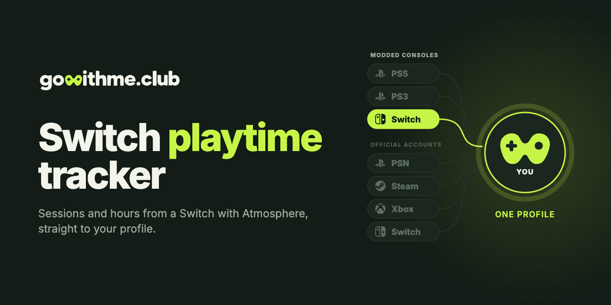

<p align="center">
  <a href="https://gowithme.club"></a>
</p>

<p align="center">
  <b>English</b> · <a href="README.ru.md">Русский</a>
</p>

<p align="center">
  <a href="https://github.com/gowithme-club/switch-playtime-tracker/releases/latest"></a>
  
  <a href="LICENSE"></a>
</p>

# Switch Playtime Tracker

An open-source Atmosphere sysmodule that tracks playtime and play sessions on a
modded Nintendo Switch and syncs them to your
[gowithme.club](https://gowithme.club) profile. No Nintendo Switch Online needed.

**Requires:** a Nintendo Switch running Atmosphere, access to its SD card (card reader or FTP) and a free gowithme.club account.

## Features

- Every play session with its start, end and length, read from the console's play journal.
- Each user profile on the console tracked separately.
- Live “playing now” status on your profile; a toast shows how long you played.
- Days played offline are backfilled from the journal once the console is online.
- Starts with the system and runs in the background.

## Install

The step-by-step guide with pictures is in **Settings → Nintendo Switch (CFW)** on gowithme.club. In short:

1. On gowithme.club issue a token and download the archive (the token is already inside).
2. Power the console off completely and copy the `atmosphere` and `config`
   folders to the root of the SD card. Choose **Merge**, not Replace.
3. Boot into Atmosphere and start any game for about a minute.

The archive is also on the [releases page](https://github.com/gowithme-club/switch-playtime-tracker/releases/latest).
The module logs to `config/gowithme.club/log.txt` on the SD card.

## FAQ

**How do I track playtime on a modded Switch?**
Install this sysmodule with a token from gowithme.club. Sessions and hours then
show up on your profile.

**Do I need Nintendo Switch Online?**
No. The tracker reads the console's play journal and does not contact Nintendo
services.

**Does it count games played before it was installed?**
Yes. On the first run it uploads the launch history kept in the console's
play journal.

**Several people share one Switch. Is that a problem?**
No. Each console profile connects separately and gets its own stats.

**Does it work offline?**
Yes. Days without internet are sent from the journal once the console is
online again.

**How do I turn it off?**
In the **Sysmodules** overlay (Ultrahand or Tesla) switch off `gowithme.club`.

**What does it send?**
The game's title ID and name, session start and end times, playtime and the
console profile nickname.

**How do I remove it?**
Delete `atmosphere/contents/4200000000505341` and `config/gowithme.club` from the
SD card.

**I have a stock Switch.**
A stock Switch connects on gowithme.club by Friend Code, with no homebrew.

## Build from source

You need [devkitPro](https://devkitpro.org) with `switch-libjson-c` and `switch-curl`:

```bash
dkp-pacman -S switch-libjson-c switch-curl
make            # dist/atmosphere/contents/4200000000505341/
```

Config keys, memory budget and console measurements (in Russian): [docs/DEVELOPMENT.ru.md](docs/DEVELOPMENT.ru.md).

## Other consoles

| Console | Repository | Runs as |
| --- | --- | --- |
| PS5, jailbroken | [ps5-playtime-tracker](https://github.com/gowithme-club/ps5-playtime-tracker) | payload |
| PS3 on HEN or CFW | [ps3-playtime-tracker](https://github.com/gowithme-club/ps3-playtime-tracker) | VSH plugin |
| Switch with Atmosphere | **switch-playtime-tracker** | sysmodule |

Stock PS4 and PS5, Steam, Xbox, Nintendo Switch and Discord connect on
[gowithme.club](https://gowithme.club) without installing anything.

## Support

[Telegram support](https://t.me/gowithme_club_support) ·
[GitHub issues](https://github.com/gowithme-club/switch-playtime-tracker/issues) ·
pull requests are welcome.

## License

[MIT](LICENSE). The sysmodule skeleton comes from
[llsc12/SwitchRPC](https://github.com/llsc12/SwitchRPC) (MIT); reading play events
follows [NX Activity Log](https://github.com/tallbl0nde/NX-Activity-Log).

Unofficial homebrew, not affiliated with or endorsed by Nintendo. Nintendo
Switch is a trademark of Nintendo.
