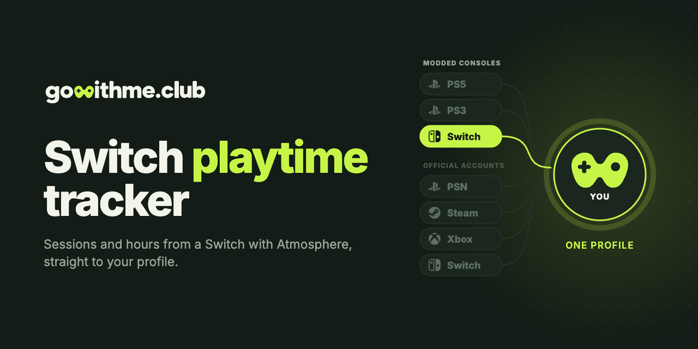

<p align="center">
  <a href="https://gowithme.club"></a>
</p>

<p align="center">
  <a href="README.md">English</a> · <b>Русский</b>
</p>

<p align="center">
  <a href="https://github.com/gowithme-club/switch-playtime-tracker/releases/latest"></a>
  
  <a href="LICENSE"></a>
</p>

# Трекер игрового времени для Switch

Sysmodule Atmosphere с открытым кодом: считает игровое время и сессии на
прошитой Nintendo Switch и отправляет их в ваш профиль на
[gowithme.club](https://gowithme.club). Nintendo Switch Online не нужен.

**Нужно:** Nintendo Switch с Atmosphere, доступ к её SD-карте (картридер или FTP) и бесплатный аккаунт gowithme.club.

## Возможности

- Каждая сессия с началом, концом и длительностью — из журнала активности консоли.
- Каждый профиль на консоли учитывается отдельно.
- Статус «сейчас играет» в профиле; при закрытии игры всплывёт, сколько вы играли.
- Дни без сети догоняются из журнала, когда консоль выйдет в интернет.
- Стартует вместе с системой и работает в фоне.

## Установка

Пошаговая инструкция с картинками — на gowithme.club в **Настройки → Nintendo Switch (CFW)**. Коротко:

1. На gowithme.club выпустите токен и скачайте архив (токен в нём уже записан).
2. Полностью выключите консоль и скопируйте папки `atmosphere` и `config` в
   корень SD-карты. Выбирайте **«Объединить»**, а не «Заменить».
3. Загрузитесь в Atmosphere и запустите любую игру примерно на минуту.

Архив есть и на [странице релизов](https://github.com/gowithme-club/switch-playtime-tracker/releases/latest).
Лог модуля — `config/gowithme.club/log.txt` на SD-карте.

## Вопросы

**Как считать игровое время на прошитой Switch?**
Установите этот sysmodule с токеном из gowithme.club. Сессии и часы появятся
в профиле.

**Нужен ли Nintendo Switch Online?**
Нет. Трекер читает журнал активности консоли и не обращается к сервисам Nintendo.

**Посчитает игры, сыгранные до установки?**
Да. При первом запуске он выгружает историю запусков из журнала консоли.

**Switch общая на несколько человек. Это проблема?**
Нет. Каждый профиль консоли подключается отдельно и получает свою статистику.

**Работает без интернета?**
Да. Дни без сети отправляются из журнала, когда консоль снова выйдет в интернет.

**Как выключить?**
В оверлее **Sysmodules** (Ultrahand или Tesla) выключите `gowithme.club`.

**Что он отправляет?**
Title ID и название игры, время начала и конца сессии, игровое время и ник
профиля консоли.

**Как удалить?**
Удалите с SD-карты папки `atmosphere/contents/4200000000505341` и
`config/gowithme.club`.

**У меня обычная Switch без прошивки.**
Обычная Switch подключается на gowithme.club по Friend Code, без homebrew.

## Сборка из исходников

Нужен [devkitPro](https://devkitpro.org) с `switch-libjson-c` и `switch-curl`:

```bash
dkp-pacman -S switch-libjson-c switch-curl
make            # dist/atmosphere/contents/4200000000505341/
```

Ключи конфига, бюджет памяти и замеры на консоли: [docs/DEVELOPMENT.ru.md](docs/DEVELOPMENT.ru.md).

## Другие консоли

| Консоль | Репозиторий | Что ставится |
| --- | --- | --- |
| PS5 с джейлбрейком | [ps5-playtime-tracker](https://github.com/gowithme-club/ps5-playtime-tracker) | пейлоад |
| PS3 с HEN или CFW | [ps3-playtime-tracker](https://github.com/gowithme-club/ps3-playtime-tracker) | VSH-плагин |
| Switch с Atmosphere | **switch-playtime-tracker** | sysmodule |

Обычные PS4 и PS5, Steam, Xbox, Nintendo Switch и Discord подключаются на
[gowithme.club](https://gowithme.club) без установки чего-либо.

## Поддержка

[Поддержка в Telegram](https://t.me/gowithme_club_support) ·
[issues на GitHub](https://github.com/gowithme-club/switch-playtime-tracker/issues) ·
пулреквесты приветствуются.

## Лицензия

[MIT](LICENSE). Каркас sysmodule взят из
[llsc12/SwitchRPC](https://github.com/llsc12/SwitchRPC) (MIT); чтение игровых
событий следует [NX Activity Log](https://github.com/tallbl0nde/NX-Activity-Log).

Неофициальный homebrew, не связан с Nintendo и не одобрен ею. Nintendo Switch —
товарный знак Nintendo.
